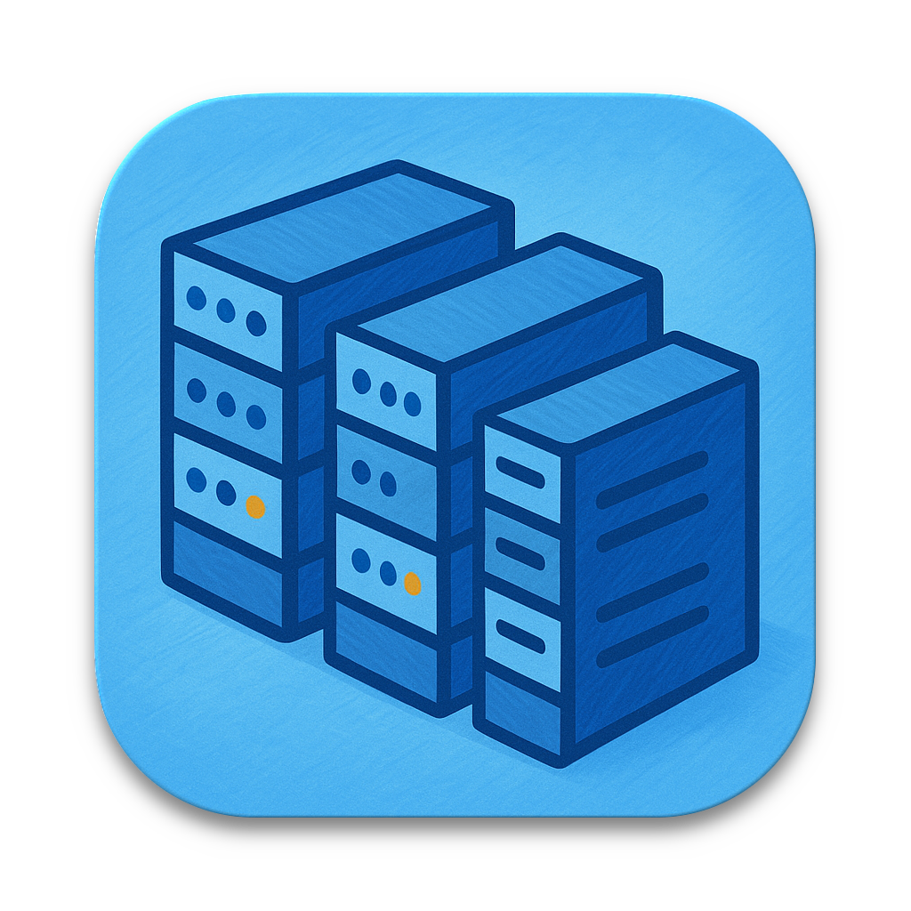
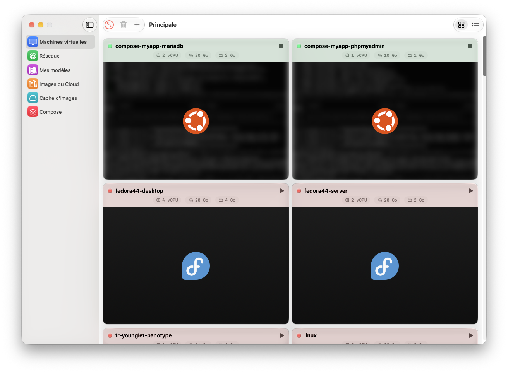
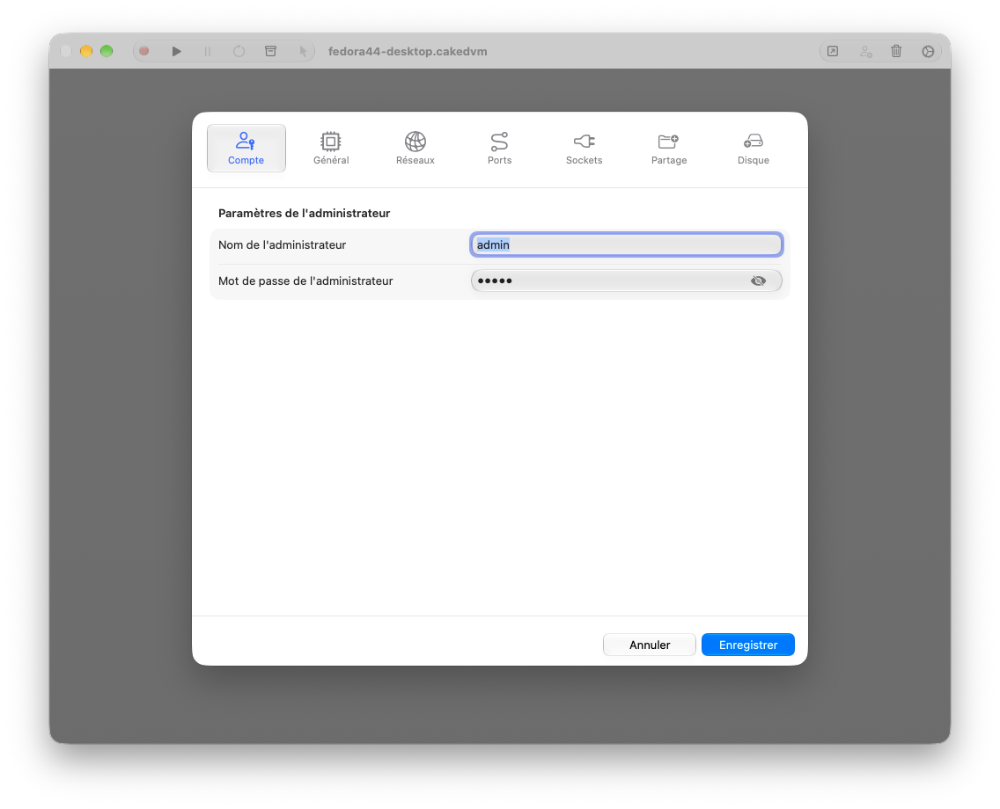
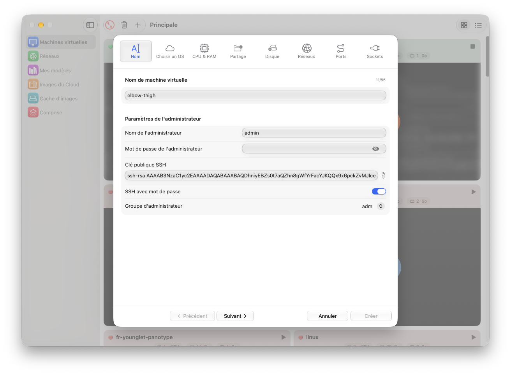

<p align="center">
	<a href="https://github.com/Fred78290/caker/actions/workflows/appstore-release.yaml"></a>
	<a href="https://github.com/Fred78290/caker/actions/workflows/release.yaml"></a>
	<a href="https://github.com/Fred78290/caker/actions/workflows/publish-wiki.yaml"></a>
	<a href="https://caker.aldunelabs.com"></a>
	<a href="https://github.com/Fred78290/caker/blob/main/LICENSE"></a>
</p>

<h1 align="center">Caker</h1>

<p align="center">
	
</p>

Caker is a macOS toolchain for building, running and managing virtual machines with Apple's Virtualization framework, focused on simplicity and developer experience. It runs **macOS and Linux guests** (and, experimentally, Windows 11) from a single CLI, a background daemon or a native desktop app.

> **Requirements**: macOS 15 or later. macOS guests require Apple Silicon.

## Highlights

**Create VMs from anywhere**
- Cloud images (qcow2/raw), installer ISOs, macOS IPSW restore images, OCI images, Simple Streams and existing templates
- A built-in **image catalog**: pick an image by short id with `--alias` (for example `--alias macos15` or `--alias ubuntu2604`) and list the available ids with `cakectl aliases`
- Import existing VMs from Multipass or VMware
- Duplicate, rename, push/pull to registries and keep reusable templates

**Unattended OS installation ("PackerLite")**
- With `--autoinstall`, Caker drives the first-boot setup for you: macOS Setup Assistant from an IPSW, or a Linux installer from an ISO (Fedora, CentOS, RHEL, openSUSE, Debian, Alpine, Ubuntu)
- Native implementation of a Packer-style `boot_command`, with OCR-based `<locate>`/`<click>` steps, no external binary or plugin
- Bundled templates for macOS 12 to 27, plus your own with `--template` and `--var key=value`
- **Record** a template by hand with `caked record`, then replay it
- Re-run provisioning later with `provision <vm>`, locally or through `cakectl`, with a live VNC view and an optional debug video of the run
- Windows 11 for ARM can be installed unattended too (see the [provisioning guide](wiki/provisioning.md))

**Compose: multi-VM environments**
- Describe a group of related VMs in a `compose.yml` (a subset of the Docker Compose format) with `depends_on` ordering, ports, volumes, networks and cloud-init extensions (`packages`, `write_files`, `post_commands`, ...)
- `cakectl compose up | down | ps | rm | ls | edit`, plus a Compose editor in Caker.app
- Built-in **DNS** so services reach each other by name (`<service>.<project>.compose.internal`, and `<vm>.compose.internal` for every running VM), with a configurable domain
- `.cakerenv` files for multi-VM environments with dependency ordering, driven by `up`/`down`

**Networking and sharing**
- Bridged, hosted and NAT networks, created and managed with `cakectl networks`
- Port forwarding between the VM and the host over TCP or Unix sockets, updated dynamically while VMs run
- Directory sharing through virtiofs
- **IMDS**: an instance metadata service for Linux guests
- Remote VNC access and an SSH-tunneled VNC client

**Guest integration**
- Cloud-Init support for VM initialization and customization
- Automatic installation of an in-guest agent, with source code in [cakeagent](https://github.com/Fred78290/cakeagent), providing `exec`, `sh`, IP discovery, resource metrics and live status

**Automation and APIs**
- gRPC API between `cakectl`, `Caker.app` and `caked`
- Optional **LXD-compatible REST API** (`caked service listen --rest`), so `lxc` and other LXD clients can talk to Caker
- A **web UI** served by `caked` at `/ui` (sources in [`webui/`](webui))
- Long-running tasks (`build`, `launch`, `provision`) can be listed and cancelled with `cakectl tasks`

## Documentation

- **📖 GitHub Pages**: [https://caker.aldunelabs.com](https://caker.aldunelabs.com) - Complete documentation with navigation and search
- **📚 Local wiki**: [wiki/home.md](wiki/home.md) - Source wiki files

| Topic | Page |
|---|---|
| Install and first VM | [Getting started](wiki/getting-started.md) |
| All commands | [Command summary](wiki/command-summary.md), [Cheat sheet](wiki/cheat-sheet.md) |
| Unattended installs and recording | [Provisioning](wiki/provisioning.md) |
| Multi-VM stacks | [Compose](wiki/compose.md), [`.cakerenv`](wiki/cakerenv.md) |
| Instance metadata | [IMDS](wiki/imds.md) |
| How the pieces fit | [Architecture](wiki/architecture.md) |
| App Store build limits | [Sandbox](wiki/sandbox.md) |
| Problems and answers | [Troubleshooting](wiki/troubleshooting.md), [FAQ](wiki/faq.md) |
| What changed | [Release notes](wiki/release-notes.md) |

The documentation is automatically synchronized from the `wiki/` directory to GitHub Pages when changes are pushed to the main branch.

## Quick start

```bash
# Run the daemon as a launchd service, then drive it with cakectl
caked service install
cakectl list

# See the images you can build from, then create and start a VM
cakectl aliases
cakectl launch --alias ubuntu2604 myvm

# Open a shell in it
cakectl sh myvm

# Unattended macOS install from the catalog
cakectl build --alias macos15 --autoinstall mac-vm

# A multi-VM environment
cakectl compose init
cakectl compose up
```

See the [getting started guide](wiki/getting-started.md) for the exact commands and options.

## Components

| Component | Role |
|---|---|
| `caked` | Core daemon: gRPC server, optional LXD REST API and web UI, `launchd` service, VM runner |
| `cakectl` | CLI client that talks to `caked` over gRPC |
| `Caker.app` | macOS desktop app and embedded VM runner |

### Caked command line

`caked` is the core daemon process that handles virtual machine lifecycle management, including building, running, and orchestrating virtual machines with configuration-driven workflows. When it runs as a service, operate it through `cakectl`.

### Cakectl command line

`cakectl` is the command-line interface used to interact with `caked`. It provides commands to:
- Build, launch and provision virtual machines
- Manage configurations, networks, templates, remotes and the image cache
- Run commands in guests, mount directories and open VNC sessions
- Manage Compose projects and inspect running tasks
- View status and control the daemon process

### Caker.app

`Caker.app` is the macOS desktop application that provides a graphical experience for working with virtual machines managed by `caked`.
It acts as the user-facing control plane of the project and is designed for day-to-day local development workflows.

<div align="center">
	<div style="vertical-align: top; display:inline-block;background-color:#f6f8fa;padding:16px;border-radius:8px">
		
		
		
	</div>
</div>

Its main role is to:
- Create and configure virtual machines from macOS with a guided wizard, including from the image catalog and the image cache
- Start, stop, pause and monitor virtual machine instances, in a mosaic or list view
- Embed and run standalone virtual machines directly in `Caker.app`, or connect to a local or remote `caked`
- Show the live display of a VM, including during unattended installation
- Record a `boot_command` template from your own clicks and keystrokes
- Manage networks, templates, remotes, Compose projects and running tasks
- Expose logs, status, and diagnostics in an accessible UI
- Integrate with the local daemon and CLI tooling without requiring manual low-level setup

A sandboxed **App Store** build is also available; a few features that need system access are unavailable there (see [Sandbox](wiki/sandbox.md)).

### Caked Service

`caked` can run as a `launchd` background service on macOS to run virtual machine workloads. It handles the core execution and management of virtual machines, including:

- **Virtual Machine Lifecycle Management**: Starting, stopping, and monitoring running virtual machines
- **Resource Allocation**: Managing CPU, memory, and storage resources for virtual machines
- **Service Registration**: Registering virtual machines as system services for persistent operation
- **Health Monitoring**: Continuously checking virtual machine health status and auto-recovery
- **Live Status**: Streaming CPU, memory, screenshots and state changes to connected clients such as `Caker.app`
- **Logging and Diagnostics**: Collecting and streaming virtual machine logs and diagnostic information

Working in conjunction with `cakectl`, the command-line control interface, `caked` provides the backend daemon that executes administrative commands and maintains the operational state of all managed virtual machines.
Together, `caked` and `cakectl` form a powerful system for virtual machine development and deployment.

## Building from source

```bash
swift build -Xswiftc -D -Xswiftc SPARKLE   # CLI tools
swift test                                  # unit tests
```

See the [development guide](wiki/development.md) for signed builds, the web UI and the integration tests.

## Security

Please report vulnerabilities responsibly using the project's security policy:

- [SECURITY.md](SECURITY.md)

## Contributing

Contributions are welcome! Please feel free to submit a pull request or open an issue to report bugs or suggest enhancements.

- Contributor guide: [CONTRIBUTING.md](CONTRIBUTING.md)
- CI workflow policy (no PR-triggered actions): [CONTRIBUTING.md#ci-workflow-policy](CONTRIBUTING.md#ci-workflow-policy)