# Caker.app: Running Linux, macOS and Windows Virtual Machines in a Native Mac App

*A tour of Caker's SwiftUI app, from creating a VM to running a multi-VM stack, without opening a terminal*

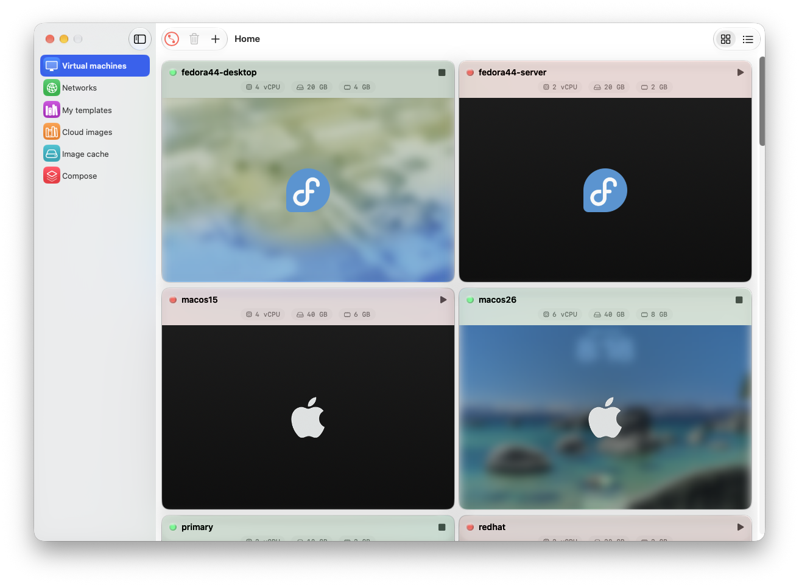

---

Caker is an open-source toolchain for running virtual machines on macOS, built on Apple's Virtualization framework. It includes a daemon (`caked`) and a command-line client (`cakectl`), but this article is about the third piece: **Caker.app**, the desktop application.

The app does almost everything the command line does, through windows, sheets and menus. You can create a VM from a cloud image, an ISO (Linux or Windows 11) or a macOS restore image, watch it install itself, open its display or a terminal, forward ports, share folders, and run several VMs together from a single YAML file. You never need to open Terminal, and if you do, the same VMs are available from `cakectl`.

Caker.app requires macOS 15 or later, and follows macOS 26's Liquid Glass design when it runs there. macOS guests require an Apple Silicon Mac, and a Windows 11 guest needs an ISO that matches your Mac (ARM on Apple Silicon, x64 on an Intel Mac). On an Intel Mac, Windows Server 2025 and Windows Server 2022 install the same way.

---

## The main window

The main window has a sidebar with one entry per kind of object:

| Sidebar entry | What it shows |
| --- | --- |
| **Virtual machines** | Your VMs, with a live screenshot of each one |
| **Networks** | The virtual networks VMs can attach to |
| **Cloud images** | Image servers (simplestreams remotes) and the images they publish |
| **My templates** | Golden images you created from your own VMs |
| **Image cache** | Images you have already downloaded |
| **Compose** | Multi-VM projects defined in a `compose.yml` |
| **Tasks** | Long-running builds in progress, when the app is connected to a `caked` daemon |

The **Virtual machines** view has two layouts, selected from the toolbar.

**Mosaic** shows each VM as a tile with a live screenshot, its status, and its CPU, memory and disk. A single click selects a VM and a double-click opens it. The power button on each tile starts or stops it.

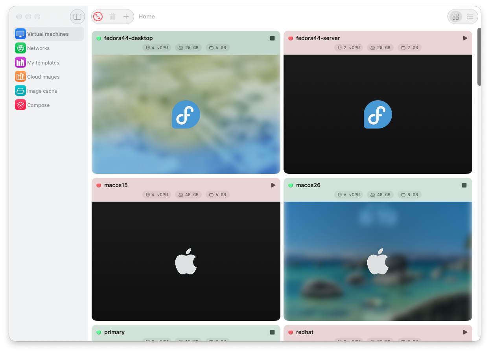

**List** shows one row per VM, with a detail pane on the right: a large screenshot, the VM's resources, and buttons to open, start, stop, pause, duplicate, rename or delete it.

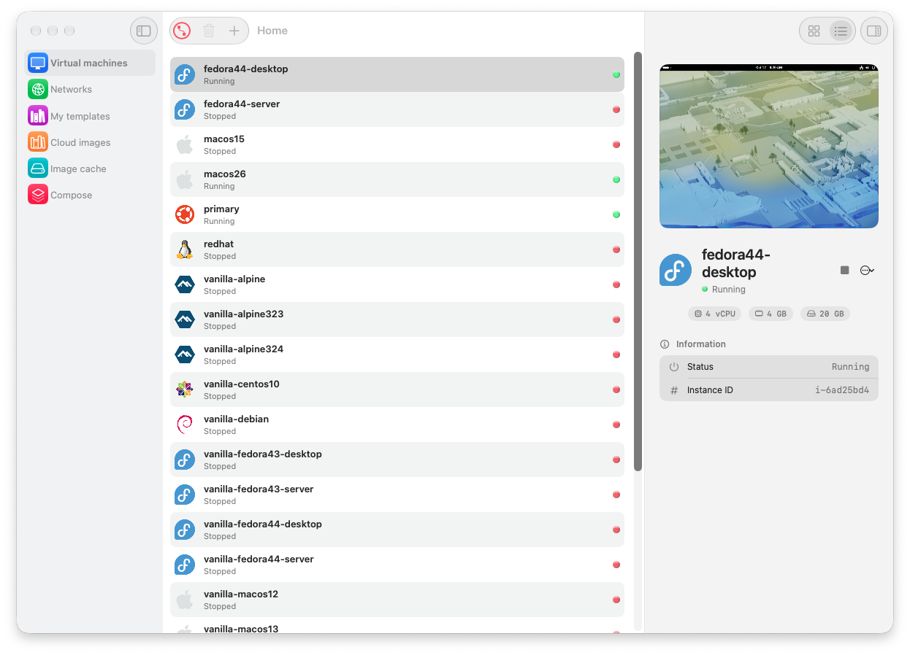

Every VM also has a context menu with the same actions (Open, Start or Resume, Stop, Pause, Duplicate, Rename, Delete), in both layouts.

---

## Creating a virtual machine

**File → New virtual machine** opens a wizard with eight steps, shown as icons in the window's toolbar: **Name**, **Choose OS**, **CPU & Ram**, **Sharing**, **Disk**, **Network**, **Ports** and **Sockets**. Only the first two need your attention for a typical Linux VM; the others have sensible defaults.

### Choosing what to install

The **Choose OS** step is where you pick the image. Its source can be:

- **qcow2**: a cloud image, picked from a list of preconfigured releases (Ubuntu, Debian, Fedora, CentOS Stream, openSUSE, Alpine), or any image URL you paste
- **iso**: a Linux installer, from a list of preconfigured ISOs or your own, or a Windows 11 ISO that you downloaded from Microsoft
- **ipsw**: a macOS restore image, from macOS 12 to macOS 27 (Apple Silicon only)
- **oci**: an image stored in an OCI registry such as GitHub Container Registry
- **template**: one of your own templates
- **stream**: an image published by a simplestreams server, such as `ubuntu:noble`
- **raw**: an existing disk image on your Mac

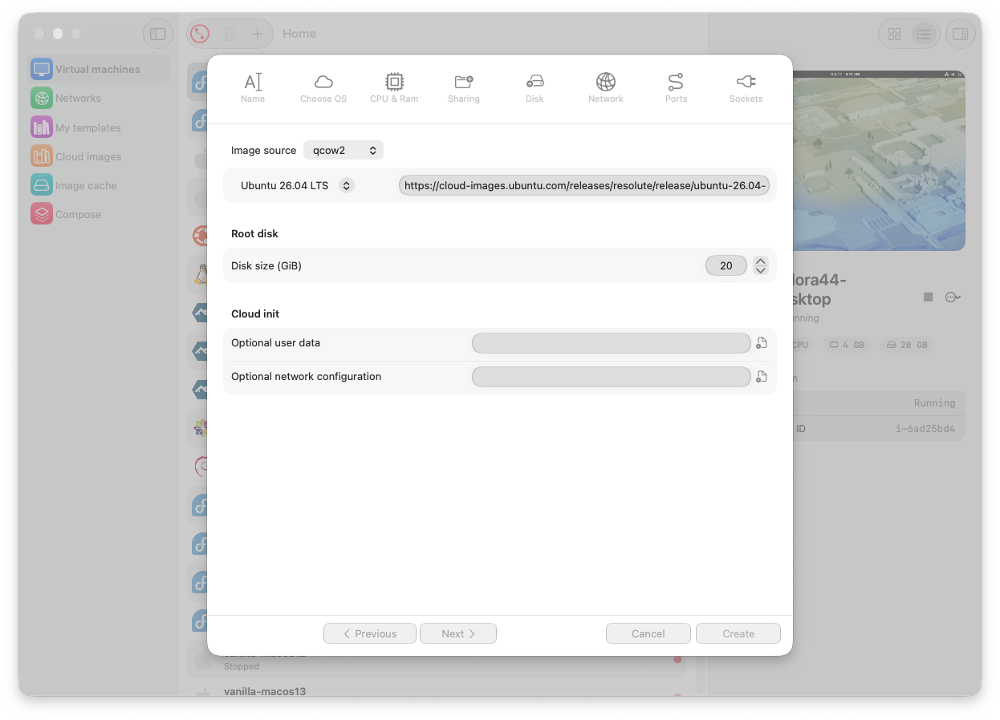

The same step holds the guest account: an **administrator name and password**, an optional **SSH public key**, and whether SSH accepts passwords. For cloud images, you can also attach your own **cloud-init user data** and **network configuration**.

### Windows 11

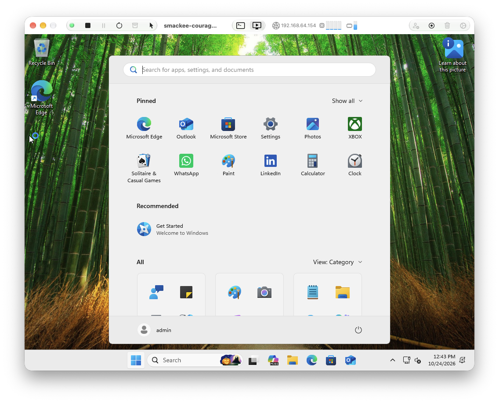

On an Intel Mac, Windows Server 2025 and Windows Server 2022 are supported as well, with the same wizard and the same unattended install.

When the ISO's file name contains `windows` (or `win11`), the wizard recognizes a Windows image and adds three Windows-only settings to the **Choose OS** step:

- **Product key**, optional, checked as you leave the field
- **Display buffer size**: the memory of the display driver, which limits how big the screen can get. The default holds a 5120×3200 display.
- **Log on automatically**: sign the account in at every start, not only the first one. Without it the guest waits at the lock screen after setup, and anything that needs a signed-in user, such as the display following your window's size, only starts once someone logs on. The password is then kept in the guest's registry in clear text, so the switch is off by default.
- **Use only WHQL-signed drivers**: installs only the drivers Microsoft signed (virtio-win's own). The desktop has no "Test Mode" watermark, but there is no sound, and the display keeps its size: the guest's window can't be resized, and **Refit display** is switched off and greyed out.

The wizard also raises the disk to at least 64 GiB. The rest works as for any other guest: pick **Configure automatically the system** and Caker does the install, as described below.

### Resources and options

Each catalog image declares the minimum CPU and memory it needs, and the wizard applies them for you. A macOS 26 guest, for example, starts at 6 CPUs and 8 GiB of RAM. If you know what you are doing, the **Allow override minimum resources** toggle lets you go lower.

The **CPU & Ram** step also has the VM's options: **Autostart** (start the VM when Caker starts), **Dynamic forward ports**, **Refit display** (resize the guest display to fit the window), **Nested virtualization**, predictable network interface names, and **Suspendable** for macOS guests. You also set the display size here.

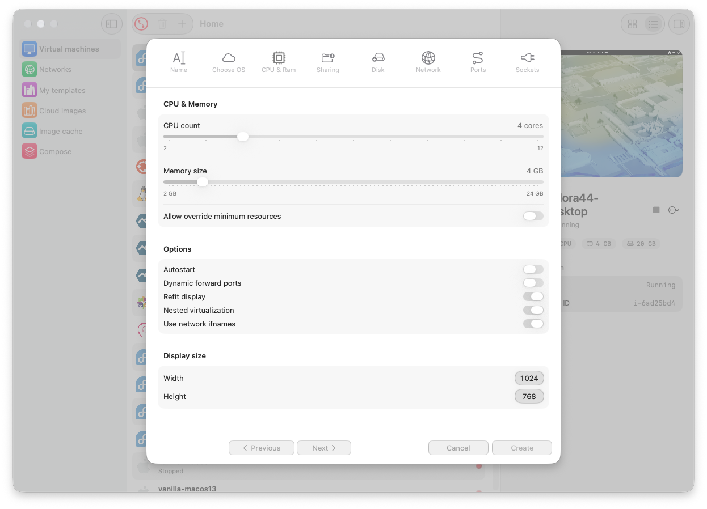

The remaining steps are lists you fill in with **+**:

- **Sharing**: folders from your Mac, shared with the guest through Virtio-FS
- **Disk**: the root disk size and format (raw, or ASIF on macOS 26+), and extra disks
- **Network**: extra network interfaces (NAT, bridged, or a network you created)
- **Ports**: port forwarding from your Mac to the guest, Docker style (`8080:80/tcp`)
- **Sockets**: Unix sockets forwarded between your Mac and the guest

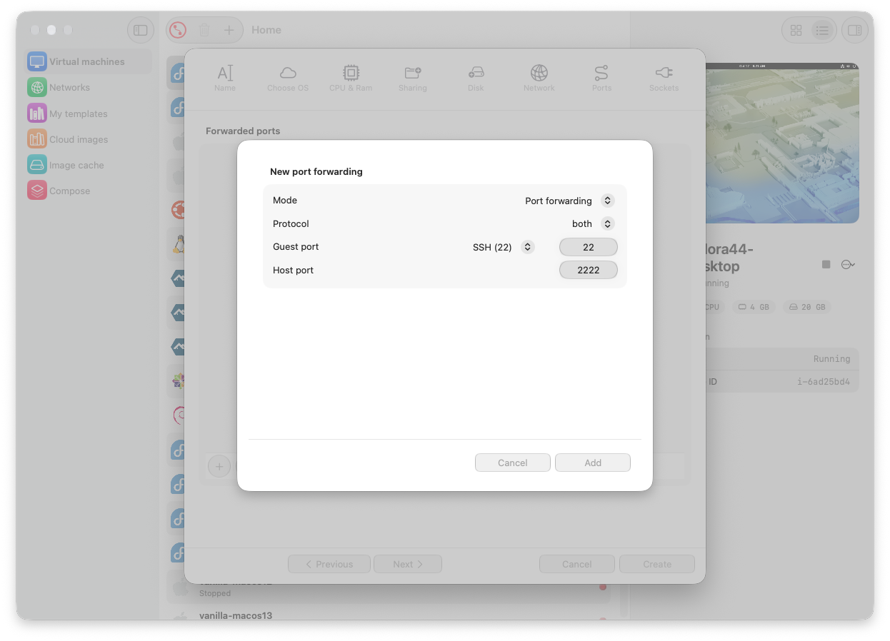

---

## Installations that finish themselves

Installing an OS from an ISO or a restore image normally means clicking through dozens of screens. When the source is an **ipsw** or an **iso**, the wizard shows a toggle, **Configure automatically the system** or **Auto configuration with provisioning**, that does it for you.

Caker then installs the OS and drives the first boot itself. It reads the VM's screen with Apple's Vision framework, then types and clicks through Setup Assistant on macOS, or through the installer on Linux. It creates your account, waits for the network, and installs Caker's guest agent. Built-in templates cover macOS 12 to 27, Fedora, CentOS Stream, RHEL, openSUSE, Debian, Alpine and Ubuntu.

For a distribution without a built-in template, the wizard asks for a template file. A **Provisioning variables** editor below the image picker lets you define values the template can use, such as subscription credentials. Values whose name contains "password" are masked.

While this runs, **the wizard shows the VM's screen live**, so you can see each screen being filled in.

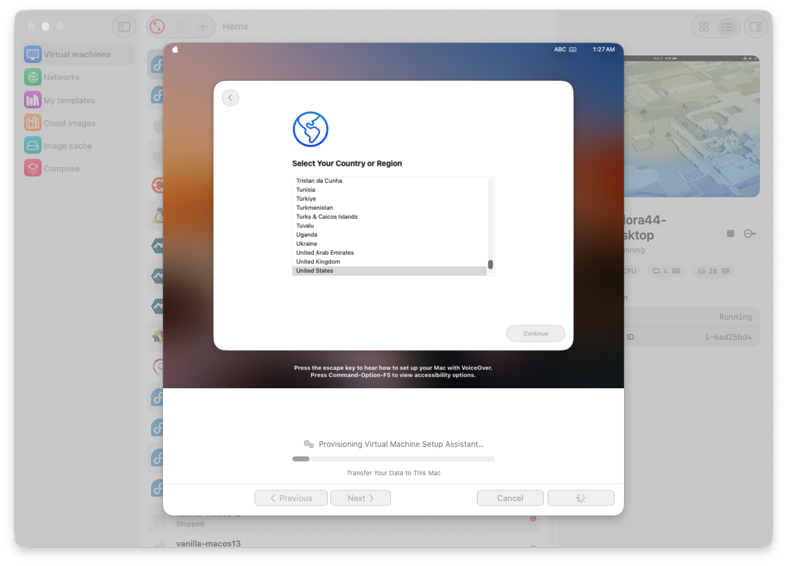

**Windows 11 works differently.** Windows' installer shows nothing on Virtualization.framework, so there is no screen to read and the wizard shows the install's progress steps instead of the VM's screen. Caker prepares a bootable disk from the ISO, applies the Windows image itself, then finishes the setup on first boot and restarts the VM until it is done. That takes about seven minutes on an M4 Pro, in whatever language the ISO is: Caker reads the image's default language and uses it for the whole setup. The VM ends up with a display that follows the VM window's size, networking, shared folders, sound, an SSH server and the Caker agent. Windows needs drivers it does not ship, and Caker supplies test-signed builds, so the desktop shows a "Test Mode" watermark. There is no TPM (no BitLocker), and a reboot started from inside the guest stops the VM, so you start it again from the app.

If an installation fails, Caker keeps a short video of the run (`provision.mp4`, in the VM's folder) so you can see the screen it stopped on.

---

## The VM window

Double-clicking a VM opens it in its own window. The toolbar holds everything you need while the VM runs:

- A **status light**, and **Start**, **Stop** and **Resume** buttons. Hold **Option** while clicking Stop to force-stop the VM instead of asking the guest to shut down.
- **Pause** and **Restart**.
- **Create template**, to turn this VM into a reusable template.
- **Show cursor**, to show or hide your Mac's pointer over the VM.
- A **CPU usage graph**, once the guest agent is running.
- An **agent** button, to install or update Caker's guest agent.
- **Recovery mode**, for macOS guests.
- **Run hosted** or **Run detached**, to run the VM inside the app or in its own background process.
- **Settings** and **Delete**.

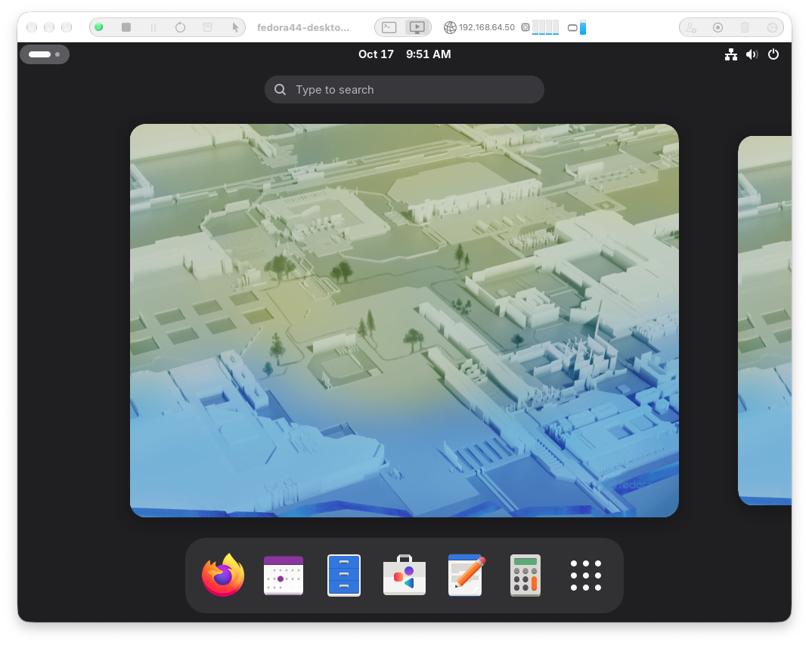

### Display or terminal

Once the guest agent is running, a segmented control lets you switch between the VM's **display** and a **terminal**. The terminal is a real shell in the guest, opened through the agent: there is no SSH to configure and no IP address to look up.

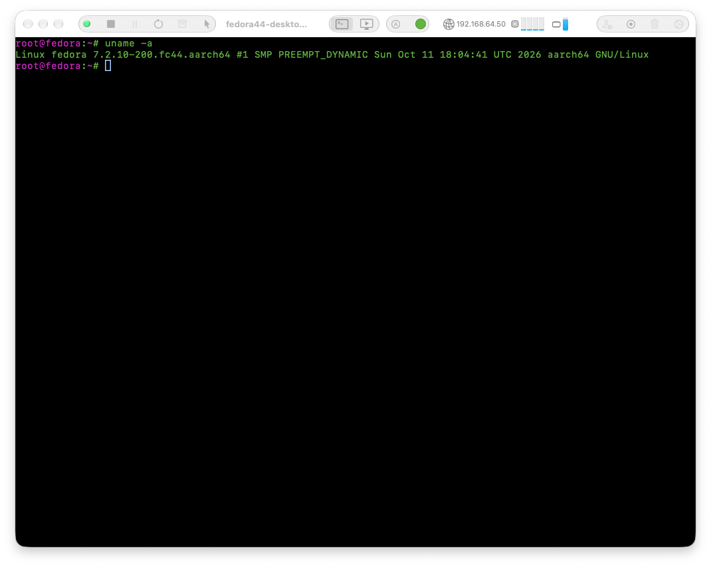

A VM running in a separate process, or on another Mac, is displayed over VNC, and can send your Mac's clipboard to the guest.

### Changing a VM's settings

The **Settings** button opens a sheet with the same sections as the wizard: CPU count, memory, disk size, options, display size, forwarded ports, network attachments, directory sharing, extra disks and sockets.

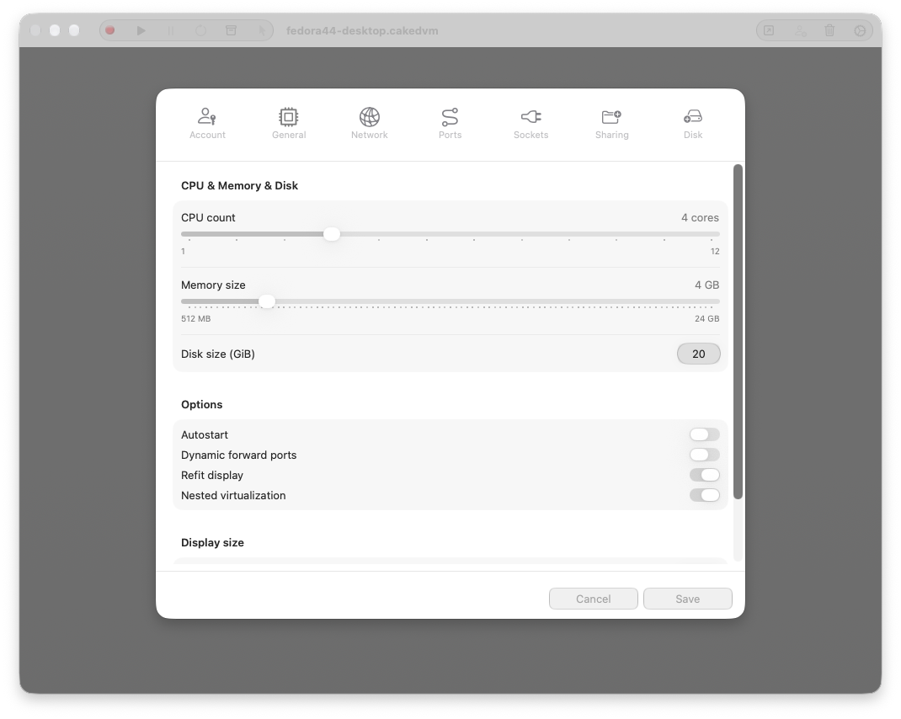

---

## Recording an installation as a template

If you need to automate an installer Caker has no template for, you can record one instead of writing it. On a running VM, click **Record** in the toolbar and go through the installer yourself. Caker saves your clicks and keystrokes as a template file (`.packerlite.yaml`) that the unattended installation can replay.

While recording, a **text recognition** toggle highlights every piece of text Caker can read on the VM's screen. With it on, a left click on a highlighted word is recorded as "click on this text", and a right click as "wait for this text to appear", rather than as screen coordinates. That makes the template work even when a screen appears at a different moment or position. A **Reset** button starts over, and for macOS guests a **VoiceOver** button records the accessibility shortcut that some Setup Assistant screens rely on.

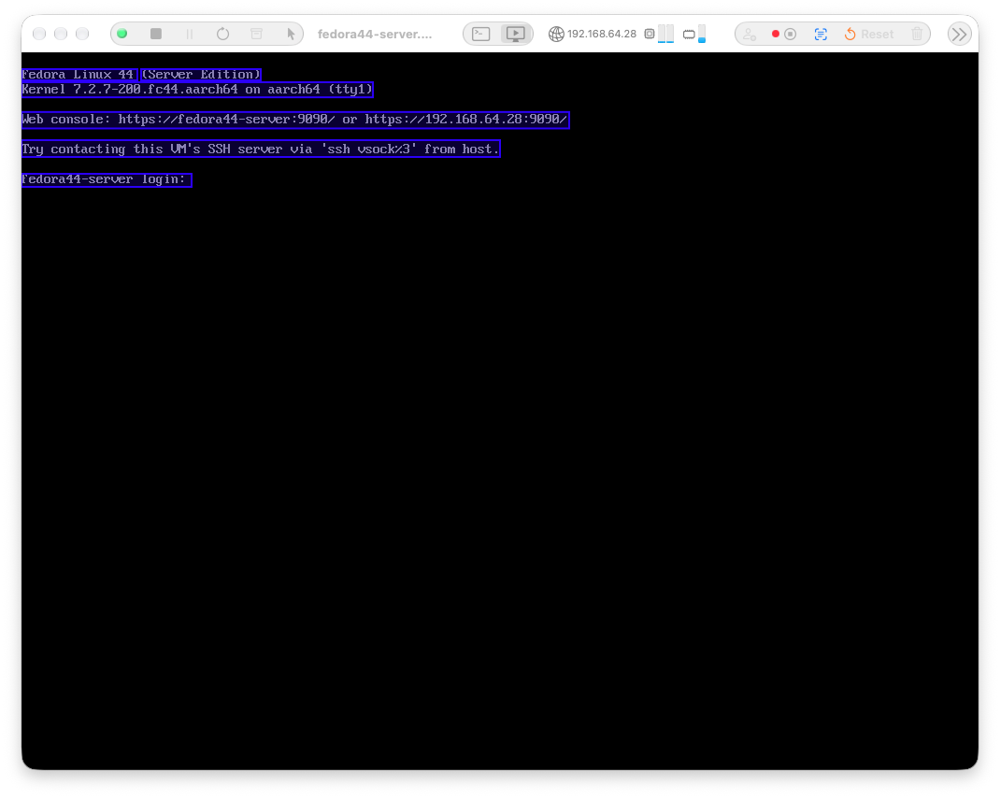

---

## Images and templates

**Cloud images** lists simplestreams servers, such as Ubuntu's. Selecting one shows the images it publishes, and **New Virtual Machine…** opens the wizard with that image already selected. The **+** button adds another server by URL.

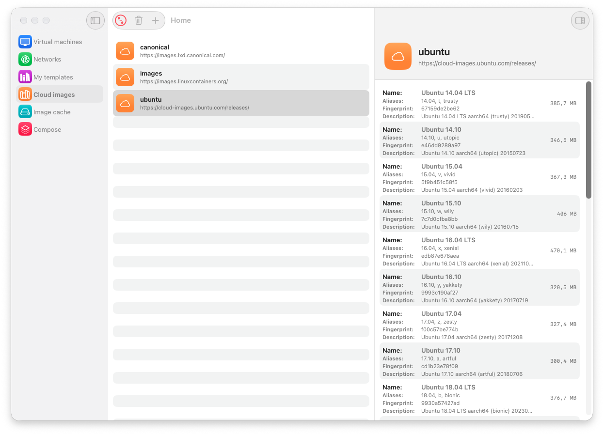

**Image cache** lists the images you have already downloaded: cloud images, ISOs, macOS restore images and OCI images. The **+** button creates a VM from the selected image without downloading it again, and **Delete** frees the disk space.

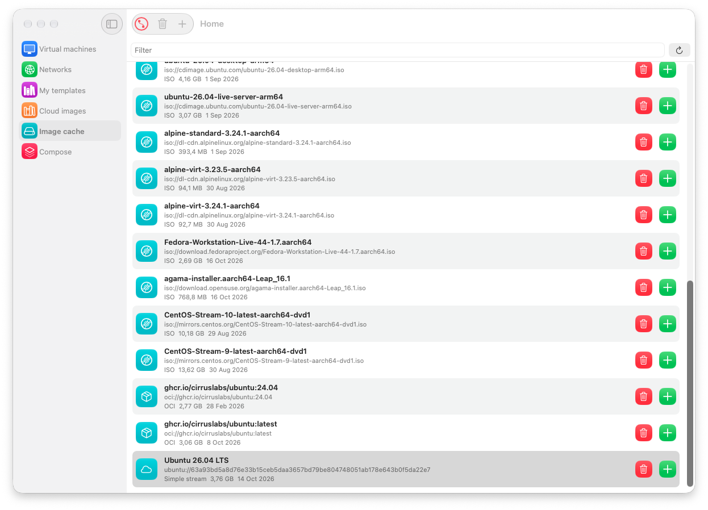

**My templates** lists the templates you created with **Create template**. From a template you can create a new VM or clone the template.

---

## Networks

Every VM gets a NAT interface by default. The **Networks** view lists the other networks available to VMs, and lets you create a **shared** network (VMs reach each other and the internet) or a **host** network (VMs reach your Mac and each other, but not the internet). For each one, you can set the DHCP range, netmask and lease time, and see how many VMs use it. **Start network** and **Stop network** are in the detail pane.

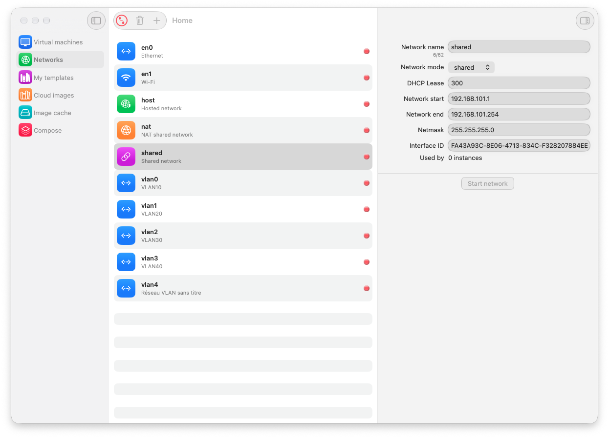

The interface used for **bridged** networking (a VM directly on your physical network) is chosen in **Settings → Advanced**.

---

## Compose: several VMs from one file

The **Compose** view manages groups of VMs described in a `compose.yml`, in the same format as Docker Compose. Each service runs as a full VM, and Caker adds fields for what a VM needs: disk size, packages to install, files to write and commands to run on first boot.

The **+** button opens the **Compose editor**, seeded with a working example: a MariaDB server and a phpMyAdmin web front end, in two VMs. The editor checks the YAML as you type and shows **Parses OK** or the error. **Add service** inserts a new service block for you, and **Save & Start** builds and starts the services in dependency order.

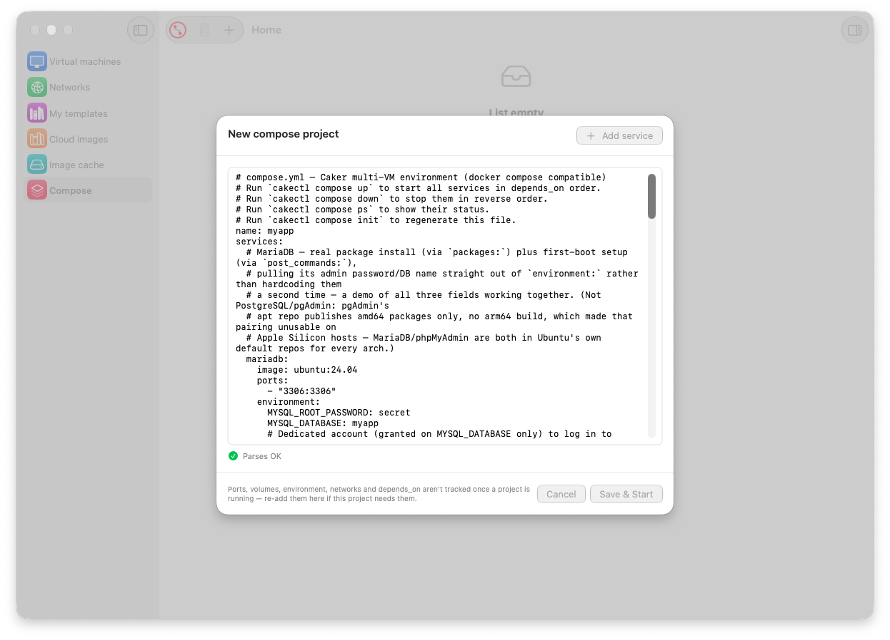

The project then appears in the list, with a count of running services ("2/2 running"). Its detail pane shows each service's status and image.

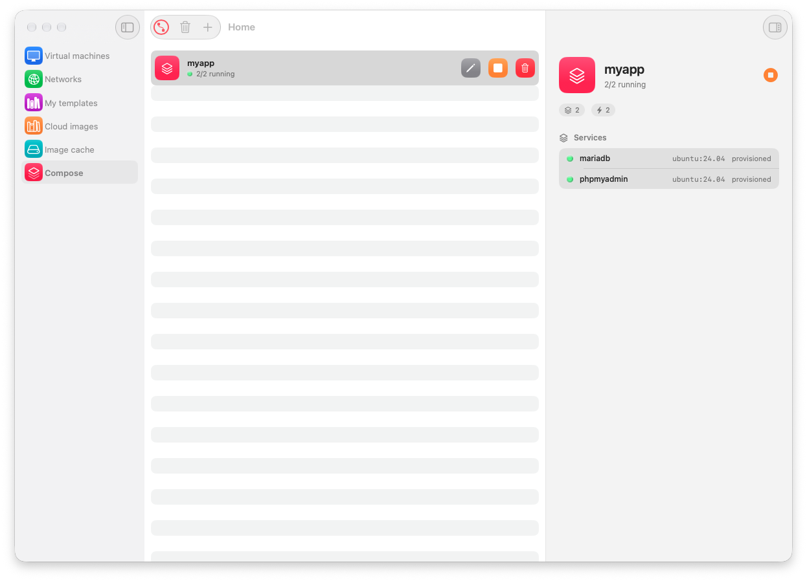

Services can reach each other by name: in the example, phpMyAdmin connects to `mariadb.myapp.compose.internal`. Any running VM, Compose or not, can be reached as `<vm-name>.compose.internal`. The domain can be changed in **Settings → Advanced**.

---

## Importing VMs from other apps

The **Import** menu brings in VMs from **Multipass**, **VMware**, **Tart**, **UTM** and **VirtualBuddy**. For Tart, UTM and VirtualBuddy, you can reference the existing disk instead of copying it.

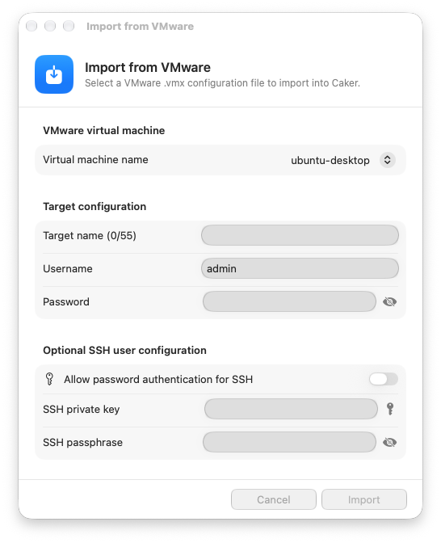

---

## Three ways to run VMs

Caker.app can work in three modes:

1. **Inside the app.** With no daemon installed, VMs run inside Caker.app itself. Nothing else is required.
2. **With a local daemon.** The **Service** menu installs `caked` as a background service, and starts or stops it. VMs then keep running when you quit the app, and are available from `cakectl` too.
3. **Connected to another Mac.** **Service → Connect to remote** opens a browser that lists the `caked` servers it finds on your local network (they announce themselves with Bonjour). You can also enter a server's address, port and optional password. The app then manages that Mac's VMs as if they were local, and the **Tasks** view shows the builds running there, which you can cancel.

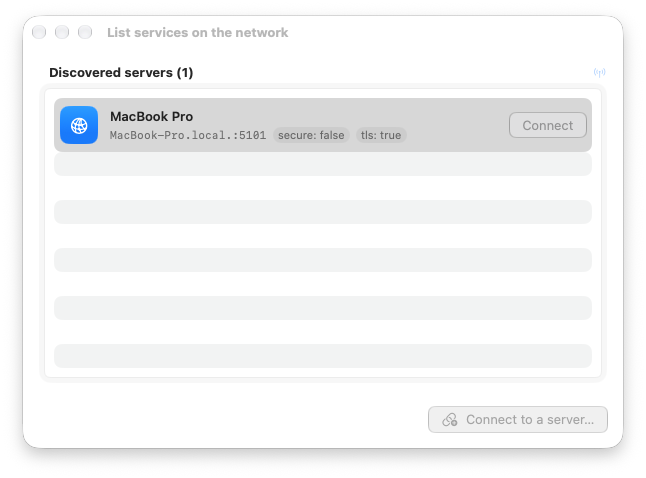

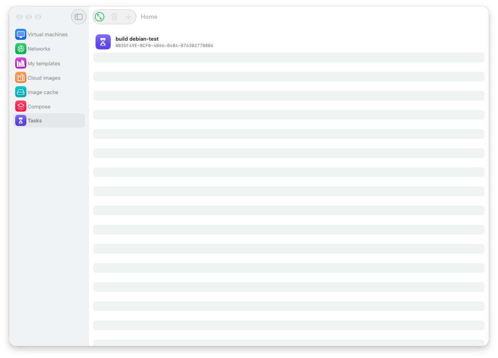

---

## The menu bar

Caker also has a menu bar icon. Its menu lists every VM, with its own Start, Stop, Request stop, Suspend or Resume, Create template and Delete actions. It also lists your Compose projects (Open, Start, Stop), has a **New compose project…** item, and the same service controls as the Service menu. With the Dock icon hidden in Settings, Caker can run as a menu-bar-only app.

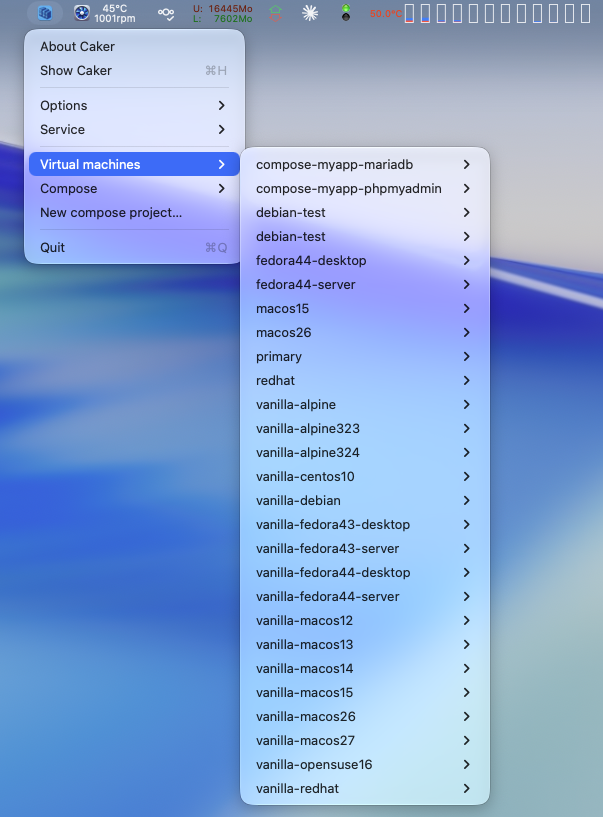

---

## Settings

The Settings window has three tabs.

- **Application**: light, dark or system appearance; Dock and menu bar icons; and **Install command-line tools**, which makes `caked` and `cakectl` available from Terminal.
- **Virtual machines**: whether VMs launch inside the app, whether closing a VM's window shuts it down, screenshots, sending the clipboard to VMs over VNC, and the restore method used for macOS installs.
- **Advanced**: the bridged network interface, the Compose DNS domain, the default VM for `cakectl sh`/`exec`, the service pass-phrase, moving all VMs and images to another folder or disk (**Relocate…**, direct-download edition only), and an AWS-style metadata service (`169.254.169.254`) for Linux guests.

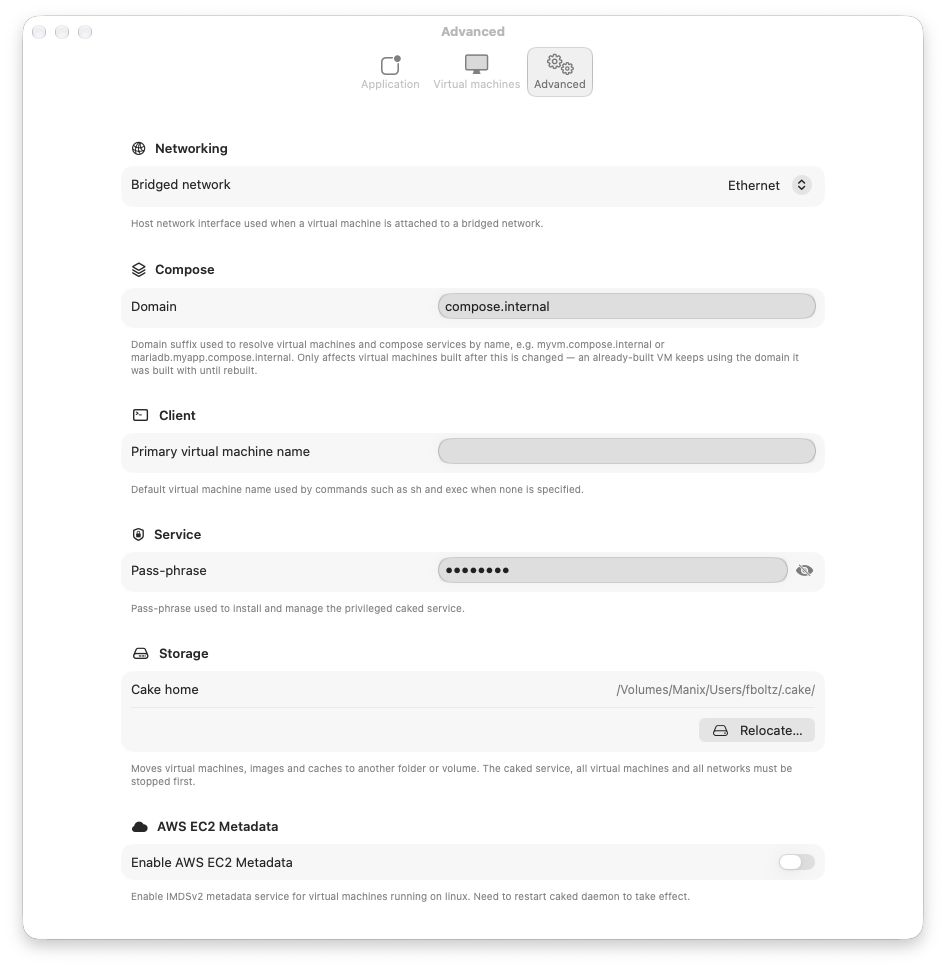

---

## Direct download or App Store

Caker.app comes in two editions:

- **Direct download** from [GitHub Releases](https://github.com/Fred78290/caker/releases), with automatic updates.
- **App Store edition**, which runs in the macOS App Sandbox. A few features need privileges the sandbox does not allow: the Windows 11 installer, name resolution between VMs, the metadata service's `169.254.169.254` address, attaching physical disks, and resizing ASIF disks from the command line. The app lists them the first time it launches.

---

## Try it

- **Download and source code**: [github.com/Fred78290/caker](https://github.com/Fred78290/caker)
- **Documentation**: [caker.aldunelabs.com](https://caker.aldunelabs.com)

Caker is open source, under the AGPL-3.0 license. If you try the app, I would like to hear what works for you and what is missing: issues and pull requests are welcome on GitHub.

---

*Tags: macOS, Windows, Virtualization, SwiftUI, Mac Apps, Developer Tools*
